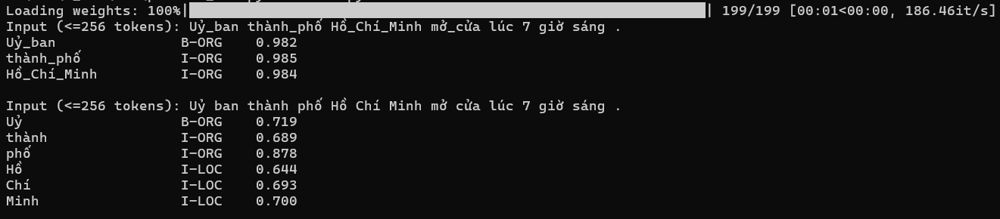

# Nhận dạng thực thể tên (NER) tiếng Việt với PhoBERT

Fine-tuning `vinai/phobert-base` cho bài toán nhận dạng thực thể tên tiếng Việt trên bộ dữ liệu VLSP2016, gán nhãn BIO với 4 loại thực thể: PER, ORG, LOC, MISC.

Kết quả trên tập valid: **F1 0.9473** (Precision 0.9460, Recall 0.9487).

## Dữ liệu

Tại thời điểm thực hiện (10/2026) không truy cập được trang chính thức của VLSP để lấy bản gốc, nên dự án dùng bản trên Hugging Face( `datnth1709/VLSP2016-NER-data`), chỉ có tập `train` và `valid`.

- Train: 13.486 câu
- Valid: 3.372 câu
- Nhãn (9 nhãn): `O`, `B-PER`, `I-PER`, `B-ORG`, `I-ORG`, `B-LOC`, `I-LOC`, `B-MISC`, `I-MISC`

## Kết quả trên tập valid

Tổng quan:

| Chỉ số         | Giá trị |
| :--------------- | :-------: |
| F1               |  0.9473  |
| Precision        |  0.9460  |
| Recall           |  0.9487  |
| Accuracy (token) |  0.9952  |
| Eval loss        |  0.0222  |

F1 theo từng loại thực thể:

| Thực thể |   F1   | Số thực thể |
| :--------: | :----: | :------------: |
|    PER    | 0.9827 |      1502      |
|    LOC    | 0.9396 |      1315      |
|    MISC    | 0.9369 |       54       |
|    ORG    | 0.7950 |      266      |

## Cách chạy

```bash
pip install -r requirements.txt
python data.py     # tạo ./processed_vlsp2016
python train.py    # huấn luyện, lưu model vào ./best_model
python main.py     # đọc model từ ./best_model, demo: nhập câu, Enter chuỗi rỗng để thoát
```

## Huấn luyện

Huấn luyện bằng Hugging Face `Trainer`, chọn checkpoint tốt nhất theo F1 trên valid, đánh giá bằng `seqeval`.

| Siêu tham số |       Giá trị       |
| -------------- | :--------------------: |
| Mô hình nền | `vinai/phobert-base` |
| Learning rate  |          2e-5          |
| Epoch          |           5           |
| Batch size     |           16           |
| Weight decay   |          0.01          |
| Seed           |    42 (mặc định)    |

Tổng 4215 bước, F1 valid theo epoch:

| Epoch |                     F1                     |
| :---: | :-----------------------------------------: |
|   1   |                   0.9240                   |
|   2   |                   0.9419                   |
|   3   |                   0.9439                   |
|   4   | **0.9473** (checkpoint được chọn) |
|   5   |                   0.9450                   |

## Cấu trúc dự án

| File         | Chức năng                                                                                     |
| ------------ | ----------------------------------------------------------------------------------------------- |
| `data.py`  | Tải VLSP2016, tokenize, căn chỉnh nhãn BIO theo subword, lưu vào `./processed_vlsp2016` |
| `train.py` | Huấn luyện bằng `Trainer`, đánh giá bằng `seqeval`, lưu model vào `./best_model` |
| `main.py`  | Demo dòng lệnh: nhập câu, in ra từng token, nhãn và độ tin cậy                        |

## Ghi chú

- Tokenizer của PhoBERT là bản slow (`PhobertTokenizer`), không có `.word_ids()`, nên nhãn được căn chỉnh thủ công: subword đầu tiên của mỗi từ giữ nhãn gốc, các subword còn lại gán `-100`.
- Dữ liệu đầu vào (cả lúc huấn luyện và khi chạy `main.py`) cần được tách từ sẵn: VLSP2016 đã tách từ, các âm tiết của cùng một từ được nối bằng `_`, ví dụ: `Ủy_ban`, `Hồ_Chí_Minh`.
- Bộ dự liệu chỉ có `train` và `valid`, không có tập `test`, nên kết quả được đo trên `valid`. Checkpoint cũng được chọn theo F1 trên `valid` nên kết quả có thể hơi lạc quan so với một tập test độc lập.

## Hạn chế

- **Đầu vào phải tách từ sẵn.** Nếu không nối từ bằng `_`, câu bị tách thành từng âm tiết, độ tin cậy giảm và nhãn có thể sai.

  Ví dụ: với cùng một câu (token nhãn `O` không được hiển thị): khi nối từ, `Ủy_ban thành_phố Hồ_Chí_Minh` được nhận thành một cụm ORG với độ tin cậy trong khoảng 0.982 - 0.985 . Khi không nối từ, độ tin cậy giảm còn 0.693 - 0.878 và `Hồ Chí Minh` bị gán `I-LOC` thay vì `I-ORG`.

  
- Mô hình dự đoán nhãn từng token độc lập, nên đôi khi sinh chuỗi nhãn không hợp lệ (ví dụ: ở ảnh trên, `I-LOC` xuất hiện mà không có `B-LOC` đứng trước), nhất là khi đầu vào chưa tách từ.
- `data.py` không cắt độ dài, nên câu dài hơn 256 token sẽ làm lệch độ dài `input_ids` và `labels`. Bộ dữ liệu hiện tại không bị ảnh hưởng (câu dài nhất 122 token).
- `main.py`: input dài hơn 256 token vượt giới hạn position embedding của PhoBERT và gây lỗi khi chạy, chưa xử lý ở phiên bản này.

## Hướng phát triển

- Tích hợp bộ tách từ để `main.py` nhận được văn bản thô, không cần người dùng tự tách từ và nối `_`.
- Ràng buộc chuyển nhãn BIO khi giải mã, để tránh chuỗi nhãn không hợp lệ (xem lại phần hạn chế).
- Xử lý input dài hơn 256 token ở `main.py`: chia văn bản thành nhiều đoạn, nhận dạng từng đoạn rồi gộp kết quả.
- Phân tích nguyên nhân ORG có điểm F1 thấp (0.7950) và cập nhật phiên bản tốt hơn.
- Tìm bộ dữ liệu mới có tập `test` riêng, hoặc tách tập `test` từ `train` (giữ `valid` để chọn checkpoint) rồi huấn luyện lại, để đánh giá khách quan hơn. Nếu dữ liệu mới có câu dài hơn 256 token thì bổ sung `truncation` ở `data.py`.

## Công nghệ

Python · PyTorch · Hugging Face Transformers · Datasets · seqeval
